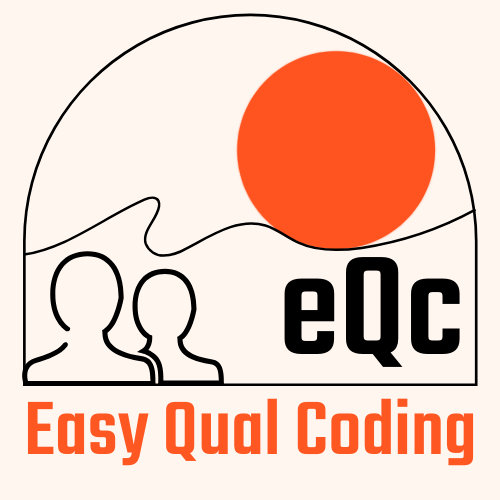



  

# eQc — Easy Qual Coding

**Version 1.8.3** · A local desktop app for qualitative research.

  

If you use eQc in published work, please cite it using the **Cite this repository** link on the GitHub page (APA and BibTeX), or the metadata in [`CITATION.cff`](CITATION.cff).

Import interviews, field notes, documents and images; code passages and regions; organise your codebook; write memos; and explore your analysis. No account or cloud upload is required.

Visualization includes 17 coordinated colour presets with order inversion, expanded text/shape colour pickers, and a working canvas that resumes after source navigation while the renderer unloads in other tabs.

## Downloads and Help

- [Latest release](https://github.com/anisur-bayazid25/eQc/releases/latest)
- [Complete user guide](USER_GUIDE.md)
- [Application reference](DOCUMENTATION.md)
- [Release notes](RELEASE_NOTES.md)
- [Changelog](CHANGELOG.md)

The **Help** tab includes the complete guide and application reference offline. Search a function or open a section to find instructions and examples.

## System requirements

| Component | Minimum | Recommended |
| --- | --- | --- |
| Windows | Windows 10, 64-bit (x64) | Windows 11, 64-bit (x64) |
| macOS | macOS 10.15 on Intel; macOS 11 on Apple Silicon | A currently supported macOS release; matching Intel or Apple Silicon installer |
| Processor | 64-bit, 2 cores | 4 cores or more |
| Memory | 4 GB RAM | 8 GB RAM; 16 GB for large PDFs, frequent OCR or heavy multitasking |
| Free storage | 1 GB for installation, plus space for projects and backups | SSD with 5 GB free, plus project and backup storage |
| Display | 1366 × 768 | 1920 × 1080 or higher |
| Graphics | Integrated graphics | Integrated graphics; no dedicated GPU required |

**The hardware minimum is a provisional baseline for routine text coding, not a verified low-spec performance guarantee.** Large source collections, scanned PDFs and dense visualizations need more resources. The operating-system floor follows the current [Electron 31 runtime](https://github.com/electron/electron/blob/v31.7.7/README.md#platform-support); macOS installers are configured for Intel and Apple Silicon. There is currently no configured Linux release installer.

Normal coding, analysis and Help work offline. Installation downloads and updates need internet. OCR runs locally, but its current setup retrieves engine and Bengali/English language assets from online services; allow internet when using OCR. Offline OCR availability depends on those assets being available in the cache and is not guaranteed.

**OCR languages:** scanned-PDF recognition currently uses Bengali and English only. Other OCR languages are not selectable. This limitation applies to scanned-text recognition, not ordinary imported text; language choices in Word Cloud and word-frequency analysis do not change OCR recognition.

**Project and backup storage:** embedded images use base64, which adds roughly 33% to their binary size. HEIC-to-PNG conversion, retained original documents and PDF page images can add more. Photo-heavy projects can exceed 1 GB each; full JSON backups containing that media require additional space for every saved copy. The 1 GB installation allowance does not include project data or backups.

## What's new in 1.8.3
- **Visualization workspace:** sixteen diagram types, including Word Cloud, five Sankey presets, guided Histomap/Dendrogram setup and one dedicated Blank canvas. Code map offers Simple and Detailed designs.
- **Figure editing:** edit text in place, draw standard shapes, group/align/resize objects, edit legends and apply 17 palettes or named custom palettes. The working canvas resumes after source navigation.
- **Word Cloud:** shaped clouds and PNG/SVG masks, adjustable spacing, frequency/uniform sizing, local refitting and language-aware word filters shared with word frequencies.
- **Bug reports and feedback:** send a bug report, feature request or general message from inside the app (toolbar, Help, or Ctrl/Cmd+Shift+B). Describe the problem, attach a screenshot with an optional device note, and eQc emails it to the maintainer. A copy can be saved as a ZIP to send manually when you are offline.
- **Comfort and reliability:** a clearer Inspector, readable light-mode buttons, profile-photo positioning/zoom, expanded keyboard selection and fixes for coder filters, legends, view saves and document cleanup.
- **Help and demo:** system requirements, refreshed offline instructions and uneven fictional coding with period assignments for statistical diagrams.

## Previous release: 1.8.2
- **Memo-Book:** a top tab after Analysis that gathers notes from documents, codes, quotations, cases, annotations, matrices and Code Map, with links back to their sources.
- **Writing and export:** search, filter and select memos; export one, several or all to Word or Excel. Excel separates memo categories into worksheets. Manuscript skeletons now include analysis memos and linked research notes.
- **Clearer Help:** concise offline instructions, a dedicated Memo-Book section, and Research tools focused on Cases, Groups, Review and History.
- **About links:** right-click the email or GitHub link to copy its address without extra buttons.
- **Large memo lists:** indexed source lookups, paged cards and one memo collection per manuscript export reduce repeated work.
- **Fictional demo study:** four English interviews, three simulated coders, a questionnaire/codebook, starred evidence, memos and analysis previews.

## Research workflow

1. Create a project and add sources in **Workspace**.
2. Create codes, select a passage or image region, and apply a code.
3. Use **Codebook** for definitions, summaries, merge and export.
4. Open **Workspace → Research tools** for cases, groups, queries and recovery history.
5. Use **Analysis** for frequencies, matrices, framework analysis, text searches, ICR and Consensus. **Visualization** offers a square-card library of editable code/mind/hierarchy maps, heat maps, word trees, word clouds (shapes and PNG/SVG masks), five Sankey presets, histomaps, dendrograms, and process/journey/pyramid/Venn/honeycomb/ecology diagrams, with presets, manual drawing, named drafts and SVG/image export. Generation runs only when requested.
6. Use **Memo-Book** to link evidence, develop writing and export notes or a manuscript skeleton.
7. Export selected coding, analysis reports and regular JSON project backups.

## Files and sharing

Documents: TXT, Markdown, DOCX and PDF; scanned PDFs support local OCR. Images: PNG, JPEG, GIF, WebP, BMP and HEIC/HEIF. Structured CSV datasets, codebooks and Word-comment coding can also be imported.

Project import accepts JSON, QDPX, QDC and extracted QDE files with their matching sources. Project export offers JSON or QDPX, with original attachments or smaller plain-text document data. Selected coding exports to Word/CSV; Memo-Book exports to Word/Excel; analysis reports export to HTML. JSON is the complete eQc backup format and can include the selected profile and time history.

LAN collaboration shares research projects with colleagues on a trusted local network. Profiles and personal time records are kept separate from LAN sessions.

## Try the fictional demo

For instructions, use the [current user guide](USER_GUIDE.md). The [complete v1.6.4 guide](USER_GUIDE_v1.6.4.md) is retained as a historical reference.

Import [the ready-to-use project](demo/climate-resilience/dataset/03_READY_TO_IMPORT_EQC.json) through **Project tools → Import**. The [demo kit](demo/climate-resilience/eQc_Fictional_Climate_Demo.zip) also includes an uncoded starter and individual coder projects.

All people, interviews, events and findings are invented for training. Three simulated coder identities support ICR and consensus demonstrations; they are not authenticated user accounts.

## Development

Install dependencies with `npm install`. `npm run dev` starts the development app, `npm run check` checks TypeScript, `npm run build` creates the web bundle, and `npm run pack -- --publish never` packages Windows without publishing.

Feature checks: `node --test tests/data-integrity.cjs tests/release-1.6.4.cjs tests/release-1.7.0.cjs tests/code-report.cjs tests/formatted-mapping.cjs tests/source-lines.cjs`.

For browser checks without starting Electron, install Playwright and its Chromium browser, set `EQC_BROWSER_CHANNEL=chromium`, and run `node tests/run-browser-checks.cjs`. The runner starts and stops a temporary Vite server. Without the browser-channel setting, it uses installed Microsoft Edge.

Implementation history is in [AI changelog](AI_CHANGELOG.md).

## Author and acknowledgments

Created by Anisur Rahman Bayazid. eQc gratefully acknowledges the contributions of the CARE project and BRAC James P Grant School of Public Health, BRAC University.

MIT License — see [LICENSE](LICENSE).